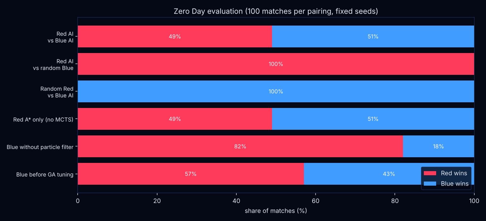
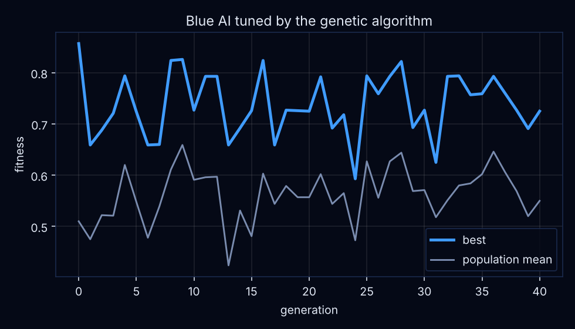

# Zero Day

**Red AI vs Blue AI on a network neither can fully see.**

Zero Day is a turn-based, hidden-information strategy game for the KUET CSE Artificial Intelligence
Laboratory final project. Two AI agents play each other on a randomly generated computer network:

- **Red** is an intruder. It starts at the gateway and tries to reach and claim the database.
- **Blue** is the defender. It knows the whole network but cannot see Red. It has to work out where Red
  probably is from noisy alerts and defend ahead of it.

Neither side sees the full board, so plain minimax is not enough. Each AI combines several classic AI
techniques, all written from scratch.


**Team:** Muttakin Rahman Shoscho (2207061) · Yasar Wajih (2207064)

---

## Quick start

```bash
python -m venv .venv && source .venv/bin/activate      # Windows: .venv\Scripts\activate
pip install -r requirements.txt
python main.py
```

Python 3.10 or newer. The game uses `pygame-ce` (regular `pygame` 2.5+ also works) and `numpy`.

| Command | What it does |
| --- | --- |
| `python main.py` | Main menu |
| `python main.py --mode ai --seed 42` | Straight into an AI vs AI match on map 42 |
| `python main.py --mode red` | You play Red against the Blue AI |
| `python main.py --mode blue` | You play Blue against the Red AI |
| `python main.py --mode ai --seed 42 --record frames` | Saves every frame (30 fps) for the gameplay video |

### Controls (AI vs AI)

| Key | Action |
| --- | --- |
| `Space` | Play / pause |
| `N` | Step one round (while paused) |
| `V` or `1` `2` `3` | Switch between Red's view, the full view and Blue's view |
| `+` / `-` | Speed (0.5x to 4x) |
| `R` | Restart on the same map |
| `M` / `Esc` | Back to the menu |
| `F12` | Screenshot |

**Playing as Red:** click a glowing neighbouring node to capture it (or unlock it across a zone border,
advance onto your own node, or claim the database). `S` scouts.
**Playing as Blue:** pick a tool with `Q` monitor, `W` patch, `E` decoy, `A` isolate, `D` restore, click a
node to use it, `Backspace` to undo, `Enter` to end the turn.

The view toggle is the best way to explain the game in the video: Red's view shows only what the intruder
has discovered (everything else is fog of war), Blue's view shows the belief map Blue builds from alerts,
and the full view shows the truth.

| Red's view | Blue's view |
| --- | --- |
|  |  |

---

## Rules

Every match uses a fresh network of 30 to 38 nodes in three zones: **DMZ** (with the gateway),
**Office** and **Data Centre** (with the database). Zones are joined by a few gated links. The generator
checks with breadth-first search that at least two node-disjoint routes lead from the gateway to the
database, so Blue can never block every route at once. A seed makes every map repeatable.

A match lasts up to **40 rounds**. Both sides choose at the same time without seeing each other's choice.
Blue's actions resolve first, then Red's. Then the engine rolls for alerts and checks who has won.

**Red (one action per round)**

| Move | Effect | Noise |
| --- | --- | --- |
| Scout | Reveals the neighbouring nodes, their weakness and their links | low |
| Capture | Takes a neighbouring node with probability = its weakness (+0.15 per earlier failed try) | medium |
| Unlock | Crosses a zone border and takes the node behind the gate | high |
| Advance | Moves onto a neighbouring node Red already holds | low |
| Claim | Used from a neighbour of the database. Wins if it succeeds | high |

**Blue (3 action points per round)**

| Move | Effect | Cost |
| --- | --- | --- |
| Monitor | Alerts in one zone are 1.6x as likely this round | 1 |
| Patch | Halves a node's weakness (once per node) | 1 |
| Decoy | Turns a node into a trap that looks very weak to Red. Stepping on it reveals Red's exact position | 2 |
| Isolate | Cuts a node off for 2 rounds. If Red is on it, Red loses it and its move | 2 |
| Restore | Takes back a node Red holds but is not standing on | 2 |

**Alerts.** An alert fires where Red acted with probability `noise × sensitivity × 1.6 (if monitored)`.
Every node also has a 2% false-alarm chance each round. Blue never knows which alerts are real.

**Winning.** Red wins by claiming the database. Blue wins by holding out for 40 rounds, or by removing Red
from the network (restoring every node it holds, ending with the gateway, which can only be sealed after
round 15 and costs the whole turn).

---

## The AIs

The engine owns the true state. Each agent only ever receives its own partial observation and returns an
action (`choose_action(observation) -> action`), so neither AI can cheat. A human player is just another
agent whose action comes from the mouse.

### Red AI: plan a route, then gamble well

| Technique | File | What it does |
| --- | --- | --- |
| **A\* search** | `agents/red/astar.py` | Plans the cheapest route to the database over the nodes Red knows. Step cost `1 + λ·risk(v)` plus the expected number of retries, with `risk(v) = sensitivity × (1 − weakness) + P_decoy(v)`. Unknown territory is reached through optimistic "fog" links, and the straight-line heuristic never overestimates, so A\* stays optimal. |
| **Information-Set MCTS** | `agents/red/ismcts.py` | Red cannot see decoys, patches or monitored zones. Every iteration samples a full hidden state from the opponent model (determinisation), then runs UCT selection (`c = 1.4`), expansion, an A\*-guided rollout and back-propagation. Statistics are shared across samples, with availability counts. Up to 1000 iterations or 200 ms per move. MCTS overrides A\*'s step only when it is clearly better on average. |
| **Opponent model** | `agents/red/opponent_model.py` | Counts where Blue's defences have shown up (zones where Red got caught, decoys found, nodes isolated just before Red stepped on them, failed captures) and turns the counts into Laplace-smoothed probabilities. They feed `P_decoy` in A\* and the sampling in MCTS. |

### Blue AI: track the unseen, defend ahead

| Technique | File | What it does |
| --- | --- | --- |
| **Bayesian particle filter** | `agents/blue/particle_filter.py` | 2000 particles, each a guess "Red is on node v". Predict (move along a link, biased toward the database), update (weight by the likelihood of the alerts and of Blue's own isolate/restore results), systematic resampling. A sprung decoy collapses the belief onto one node. |
| **Fuzzy logic triage** | `agents/blue/fuzzy.py` | A Mamdani system with triangular memberships turns alert strength, node value and belief confidence into a threat score from 0 to 100 (12 rules, centroid defuzzification). Below `watch` Blue ignores a node, above `act` it acts. |
| **Stackelberg minimax** | `agents/blue/stackelberg.py` | Blue commits first, Red replies. Blue builds candidate allocations of its 3 action points, and for each one assumes Red's best response (fast route search on Blue's map) from each likely Red position. It looks two rounds ahead with alpha-beta pruning and picks `argmax_a Σ_p b(p) · min_r U(a, p, r)`. |
| **Genetic algorithm** | `tuning/ga.py` | Tunes Blue's 13 weights (utility weights, fuzzy thresholds and membership peaks, particle motion model) offline. Tournament selection (size 3), uniform crossover, Gaussian mutation, elitism of 2. Fitness is Blue's win rate against the Red AI plus a bonus for locating Red early. Best weights are saved to `tuning/best_weights.json` and loaded automatically. |

Baseline random agents for both sides live in `agents/baseline/`.

---

## Evaluation

```bash
python -m experiments.run_batch --suite --matches 200   # every pairing in the table, fixed seeds
python -m experiments.charts                            # win-rate chart and GA fitness curve
python -m tuning.ga --pop 30 --gens 40 --matches 30     # the full GA (about 7 hours)
python -m tuning.ga --resume                            # continue a stopped GA run
```

100 matches per pairing on the same fixed seeds (maps 1 to 100), full search budgets, Blue using the
GA-tuned weights:

| Pairing | Red wins | Blue wins | Avg rounds (Red win) | Blue first locates Red |
| --- | --- | --- | --- | --- |
| **Red AI vs Blue AI** | **49%** | **51%** | 26.8 | round 2.9 |
| Red AI vs random Blue | 100% | 0% | 12.2 | - |
| Random Red vs Blue AI | 0% | 100% | - | round 3.2 |
| Ablation: Red with A\* only (no MCTS) | 49% | 51% | 26.8 | round 2.9 |
| Ablation: Blue without the particle filter | 82% | 18% | 23.2 | round 3.7 |
| Ablation: Blue before GA tuning | 57% | 43% | 27.3 | round 3.0 |

What this shows:

- The main match is balanced (49 / 51), inside the 40 to 60% target from the outline.
- Both AIs beat a random opponent in every match.
- The particle filter is Blue's most important part: without it Blue wins only 18% instead of 51%.
- GA tuning raised Blue's win rate from 43% to 51%.
- Against the tuned Blue, Red's IS-MCTS layer never overrode A\*'s step in these 100 matches, so the
  "A\* only" row is identical. Red uses MCTS to override A\* only when the sampled hidden states say
  another move is clearly better (by 0.05 in average reward); against this Blue that never happened. With
  a lower margin MCTS overrides more often but did not win more. In earlier runs against the untuned
  Blue, MCTS gave Red a 6-point edge (73% vs 67%). Making MCTS pay off against the tuned Blue is the
  main open improvement.
- The GA ran for 41 generations (30 individuals, 30 matches each) in two parts, because the first run
  was stopped by a machine restart after 13 generations. The second part was warm-started from the
  first part's best weights, and the three finalists were re-tested on 60 more maps before picking the
  winner. Fitness per generation is noisy because every generation plays on new maps.





---

## Project structure

```
engine/          game state, rules, alert model, map generator, observations, match runner
agents/red/      astar.py, ismcts.py, opponent_model.py, agent.py
agents/blue/     particle_filter.py, fuzzy.py, stackelberg.py, agent.py
agents/baseline/ random agents for both sides
tuning/          ga.py, best_weights.json, fitness curve
ui/              Pygame app: menu, network renderer, panels, effects, human input
experiments/     headless batch runner, charts, results
tests/           engine and observation checks (python -m pytest -q)
```

## Balancing notes

The outline said costs, noise levels and probabilities were starting values to be tuned. Batch runs showed
the first version was far too strong for Blue (Red won 0% of matches), so these were changed:

- Unlock is one action that crosses the border and takes the node behind it (it used to be two actions).
- Restore costs 2 and cannot pull Red off the node it is standing on (that is what Isolate is for).
- Isolate lasts 2 rounds, only one node can be isolated at a time, and it needs 2 rounds to recharge.
- Patch works once per node. Each failed capture makes the next try on that node a little easier.
- Scouting also maps the neighbours' links. The gateway can only be sealed after round 15 and costs 3 points.

Every knob is in `engine/config.py`.

## Credits

Fonts: Inter (SIL Open Font License) and DejaVu Sans Mono (free license); licences in `assets/fonts/`.
