# Zero Day

**Red AI vs Blue AI on a network neither can fully see.**

Zero Day is a turn-based, hidden-information strategy game for the KUET CSE Artificial Intelligence
Laboratory final project. Two AI agents play each other on a randomly generated computer network:

- **Red** is an intruder. It starts at the gateway and tries to reach and claim the database.
- **Blue** is the defender. It knows the whole network but cannot see Red. It has to work out where Red
  probably is from noisy alerts and defend ahead of it.

Neither side sees the full board, so plain minimax is not enough. Each AI combines several classic AI
techniques, all written from scratch.

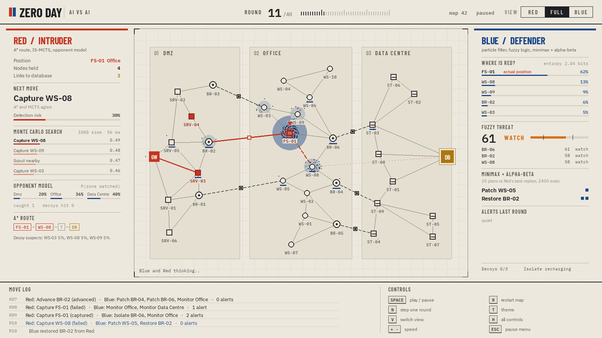

**Team:** Muttakin Rahman Shoscho (2207061) · Yasar Wajih (2207064)
**Course:** Artificial Intelligence Laboratory, Dept. of CSE, KUET

**Play it in the browser:** <https://shadowfax-505.github.io/Zero-Day/> (works on phones too)

### What's in it

- **AI vs AI**, the main mode: watch the two AIs play, pause, step round by round and switch between
  Red's view, Blue's view and the full map.
- **Human vs AI** as either side.
- **Online play**: two people (or one person and an AI, or two AIs) on two computers, over the LAN, by
  IP, or through a small relay server with a four-letter game code. Chat included.
- **Browser version** on GitHub Pages, with a proper phone layout and touch buttons.
- **Two themes**: Paper (default) and Dark, plus a settings screen and a pause menu.
- A batch runner and a genetic algorithm to measure and tune the AIs.

### The game at a glance

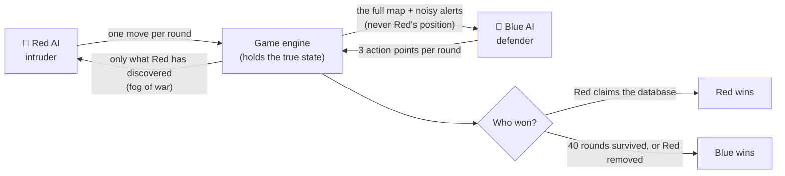

---

## Quick start

```bash
python -m venv .venv && source .venv/bin/activate      # Windows: .venv\Scripts\activate
pip install -r requirements.txt
python main.py
```

Python 3.10 or newer. The game uses `pygame-ce` (regular `pygame` 2.5+ also works) and `numpy`
(`websockets` only for online play through the relay server).

No Python? Play it [in the browser](https://shadowfax-505.github.io/Zero-Day/). Desktop apps for
Windows, macOS and Linux get attached to the [Releases](../../releases) page whenever a version tag is
pushed. [DEPLOY.md](DEPLOY.md) explains how both are published.

| Command | What it does |
| --- | --- |
| `python main.py` | Main menu |
| `python main.py --mode ai --seed 42` | Straight into an AI vs AI match on map 42 |
| `python main.py --mode red` | You play Red against the Blue AI |
| `python main.py --mode blue` | You play Blue against the Red AI |
| `python main.py --mode ai --seed 42 --record frames` | Saves every frame (30 fps) for the gameplay video |
| `python main.py --host --side red` | Host an online game as Red and wait for someone to join |
| `python main.py --join 192.168.1.20` | Join the online game hosted on that computer |
| `python main.py --join 192.168.1.20 --ai` | Join, but let your AI play your side |
| `python main.py --online --relay wss://zero-day-relay.onrender.com` | Online lobby, using that relay server |
| `python main.py --theme dark` | Starts in the dark (original neon) theme |

### Controls (AI vs AI)

| Key | Action |
| --- | --- |
| `Space` | Play / pause |
| `N` | Step one round (while paused) |
| `V` or `1` `2` `3` | Switch between Red's view, the full view and Blue's view |
| `+` / `-` | Speed (0.5x to 4x) |
| `R` | Restart on the same map |
| `Esc` | Pause menu (resume, settings, controls, restart, new map, main menu) |
| `H` | Show all controls |
| `T` | Switch theme (paper / dark) |
| `M` | Back to the menu |
| `F11` / `F12` | Fullscreen / screenshot |

Point at any node to see what the current view knows about it. The RED / FULL / BLUE buttons in the
top bar can be clicked too.

**Playing as Red:** click a marked neighbouring node to capture it (or unlock it across a zone border,
advance onto your own node, or claim the database). To scout, press `S`, click the SCOUT button at the
top of the map, or click the node you're standing on. If Blue has isolated your only way out, the
button turns into SCOUT AND PASS and a hint under the map tells you to wait it out.

**Playing as Blue:** pick a tool with `Q` monitor, `W` patch, `E` decoy, `A` isolate, `D` restore (or
click it in the tool bar above the map), click a node to use it, `Backspace` to undo, and `Enter` or the
END TURN button to finish. If a move isn't allowed the game says why (for example "Isolate needs 2 AP,
1 left"). With *Auto end-turn* on in Settings, the turn ends by itself once nothing else fits.

The view toggle is the best way to explain the game in the video: Red's view shows only what the intruder
has discovered (everything else is fog of war), Blue's view shows the belief map Blue builds from alerts,
and the full view shows the truth.

| Red's view | Blue's view |
| --- | --- |
| 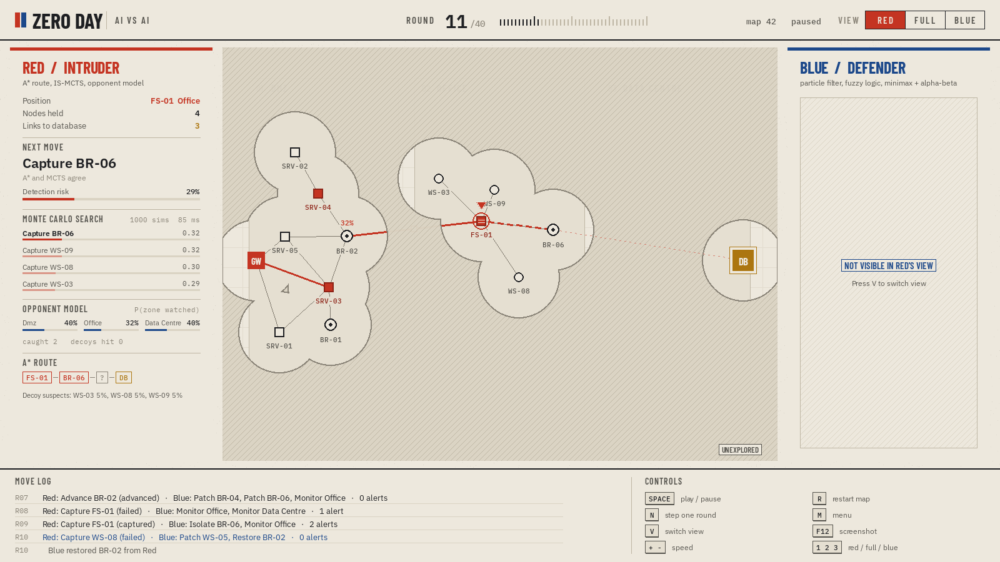 | 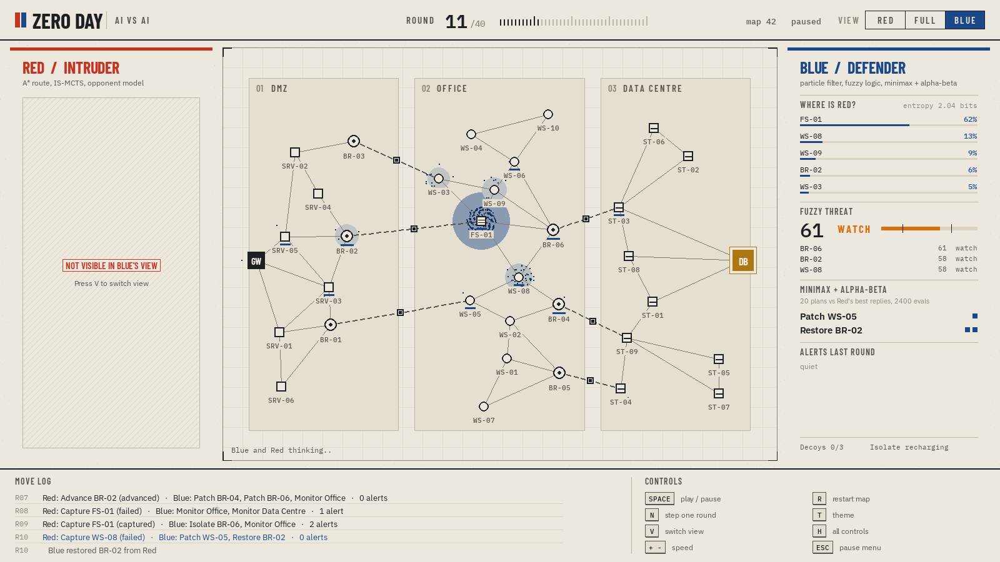 |

### On a phone or tablet

The browser version lays itself out for the screen it is on. On a phone held upright the map fills the
width (turned so the three zones stack top to bottom); on its side the map sits next to the panels. The
Red, Blue and Log panels share one tabbed pane you can drag to scroll, and a row of buttons along the
bottom does what the keys do: MENU (pause menu, the same as `Esc`), PLAY / PAUSE, STEP, VIEW and SPEED
in AI vs AI, SCOUT as Red, the five tools plus UNDO and END TURN as Blue, and CHAT online. Typing a
name or game code brings up the phone's own keyboard. Turning the phone switches layout on the spot.

On a computer, every key in the CONTROLS legend under the map can also be clicked or tapped. To try the
phone layouts on a computer: `ZERO_DAY_VIEWPORT=390x844 python main.py` (or `844x390` for landscape).

### Themes and settings

There are two themes. **Paper** (the default) draws the network like a printed operations map. **Dark** is
the original neon look. Switch with `T`, in Settings, or with `--theme dark`.

Settings (main menu or the pause menu) are saved to `~/.zero_day/settings.json`: theme, fullscreen,
node labels, hover info, animations (full or reduced), FPS counter, default speed and view, auto next
match (AI vs AI keeps playing new maps, handy for a demo loop), whether Blue's turn ends automatically
when its action points run out, and sound effects with volume.

| Paper (default) | Dark |
| --- | --- |
|  | 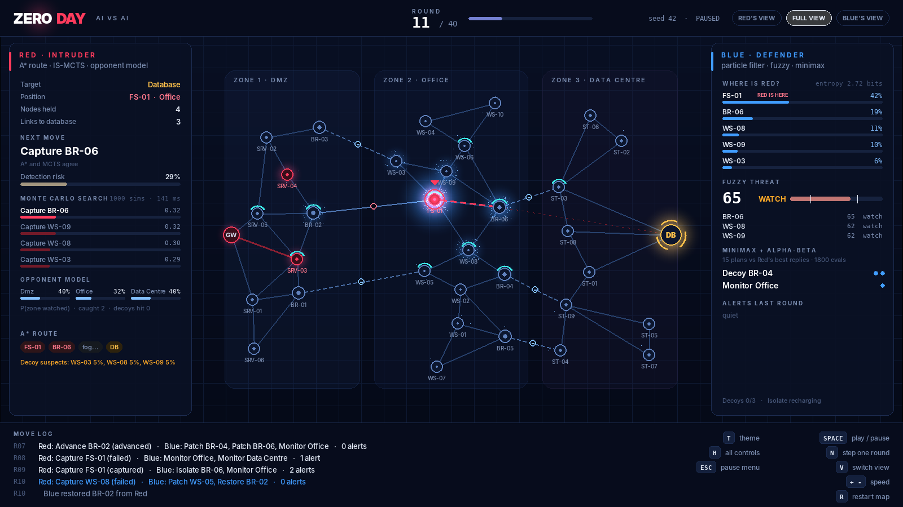 |

### Online play

Pick **PLAY ONLINE** in the menu. One player chooses **HOST A GAME**; the other sees that game under
*Games on your network* and clicks it (or types the host's address in **JOIN BY IP**). The host picks
the sides and the joiner gets the other one. Each player only ever sees their own side's view, so the fog
of war is real: Red never sees Blue's moves and Blue only sees alerts.

**WHO PLAYS IT** decides whether you play or your AI plays for you, so the same screen covers human vs
human, human vs AI across two laptops, and AI vs AI across two laptops. `C` opens chat. After a match the
host presses `R` (same map) or `N` (new map); the joiner's `R` / `N` asks the host for a rematch.

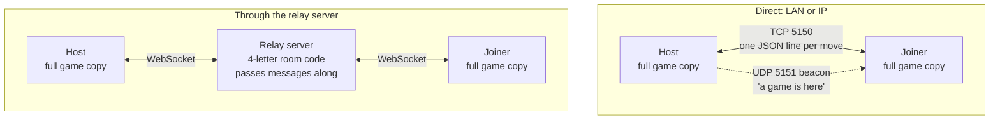

How it works: both computers build the same map from the shared seed and the engine's dice are seeded
from it too, so only the two moves travel over the network each round (one line of JSON over TCP, port
5150). Every move carries a short fingerprint of the sender's game state, so a mismatch is caught at once, and
the host then sends its full game state with its next move so the joiner's copy is repaired and the match
carries on.

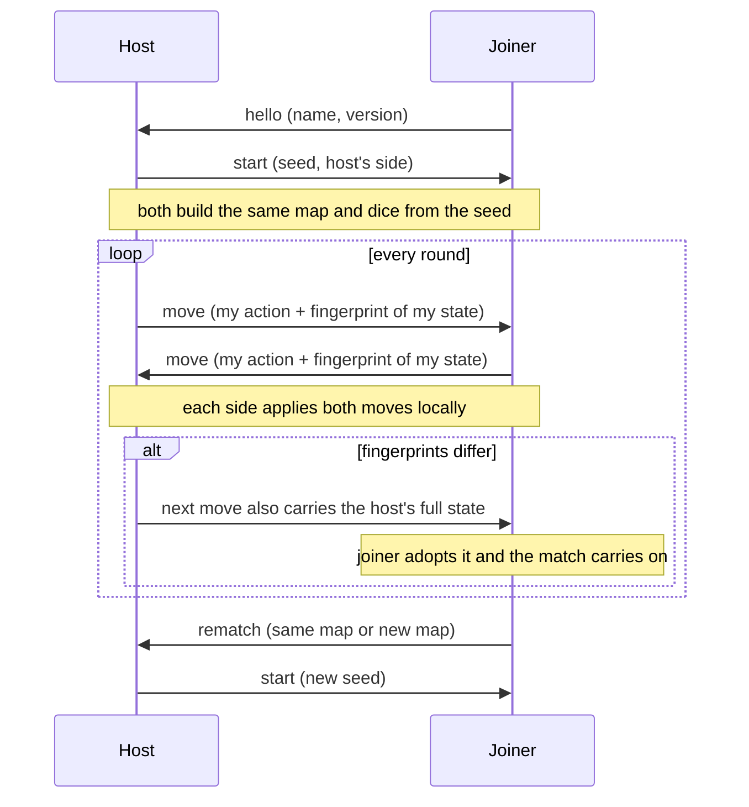
Hosts announce themselves on UDP port 5151 so they show up on the LAN without typing an IP. Over the
internet the host needs port 5150 forwarded, or both players on a virtual LAN such as Tailscale or ZeroTier.
If a firewall prompt appears the first time you host, allow it.

**Through the server.** Set **CONNECT** to *Through the server* to play anyone on any network, with
nothing to forward: **HOST A GAME** shows a four-letter code, and the other player types it in **JOIN
BY CODE** (or clicks the game in the list). This goes through a small relay (`server/relay.py`) that only
passes the two players' messages along; the match still runs on both players' computers. It is the
only option in the browser version, and a browser player and a desktop player can play each other this
way. [DEPLOY.md](DEPLOY.md) shows how to put the relay on a free Render or Fly.io server.

---

## Rules

Every match uses a fresh network of 30 to 38 nodes in three zones: **DMZ** (with the gateway),
**Office** and **Data Centre** (with the database). Zones are joined by a few gated links. The generator
checks with breadth-first search that at least two node-disjoint routes lead from the gateway to the
database, so Blue can never block every route at once. A seed makes every map repeatable.

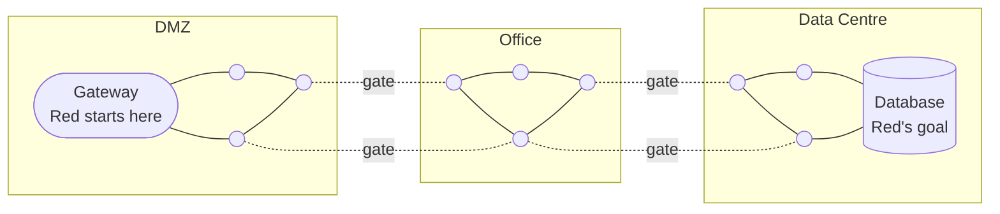

*A simplified map. Real maps have 30 to 38 nodes. Dotted lines are gated links between zones, which Red
crosses with Unlock. The generator always leaves at least two separate routes from the gateway to the
database.*

A match lasts up to **40 rounds**. Both sides choose at the same time without seeing each other's choice.
Blue's actions resolve first, then Red's. Then the engine rolls for alerts and checks who has won.

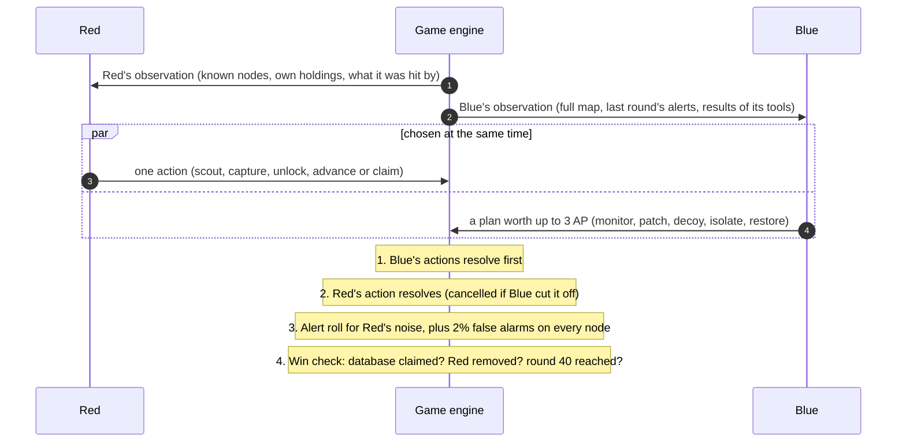

**Red (one action per round)**

| Move | Effect | Noise |
| --- | --- | --- |
| Scout | Reveals the neighbouring nodes, their weakness and their links | low |
| Capture | Takes a neighbouring node with probability = its weakness (+0.15 per earlier failed try) | medium |
| Unlock | Crosses a zone border and takes the node behind the gate | high |
| Advance | Moves onto a neighbouring node Red already holds | low |
| Claim | Used from a neighbour of the database. Wins if it succeeds | high |

**Blue (3 action points per round)**

| Move | Effect | Cost |
| --- | --- | --- |
| Monitor | Alerts in one zone are 1.6x as likely this round | 1 |
| Patch | Halves a node's weakness (once per node) | 1 |
| Decoy | Turns a node into a trap that looks very weak to Red. Stepping on it reveals Red's exact position | 2 |
| Isolate | Cuts a node off for 2 rounds. If Red is on it, Red loses it and its move. One at a time, 2-round recharge, and the same node can't be isolated again for 4 rounds | 2 |
| Restore | Takes back a node Red holds but is not standing on | 2 |

**Alerts.** An alert fires where Red acted with probability `noise × sensitivity × 1.6 (if monitored)`.
Every node also has a 2% false-alarm chance each round. Blue never knows which alerts are real.

**Winning.** Red wins by claiming the database. Blue wins by holding out for 40 rounds, or by removing Red
from the network (restoring every node it holds, ending with the gateway, which can only be sealed after
round 15 and costs the whole turn).

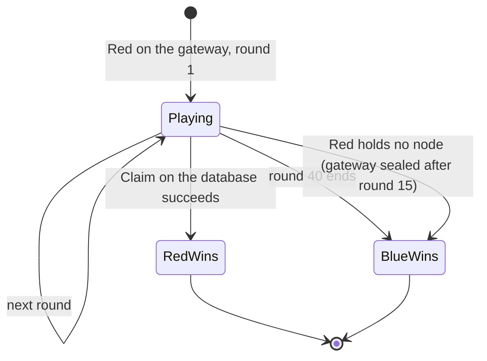

---

## Gameplay

Recordings of the three modes, captured from the game itself:

- [Human vs AI](docs/gameplay/human-vs-ai.mp4): a player as Red on map 8 against the Blue AI
- [AI vs AI](docs/gameplay/ai-vs-ai.mp4): map 42, switching between the full, Red and Blue views
- [Online](docs/gameplay/online.mp4): two connected copies side by side, host as Red, joiner as Blue

## The AIs

The engine owns the true state. Each agent only ever receives its own partial observation and returns an
action (`choose_action(observation) -> action`), so neither AI can cheat. A human player is just another
agent whose action comes from the mouse.

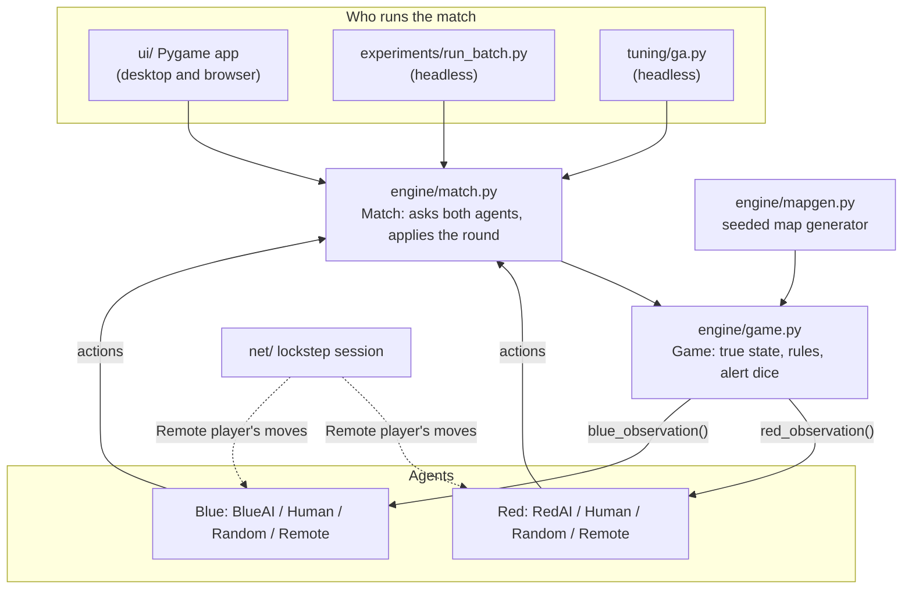

The same `Match` drives every mode. In online play, the side played on the other computer is a
`RemotePlayer` whose moves arrive over the network instead of being computed.

### Red AI: plan a route, then gamble well

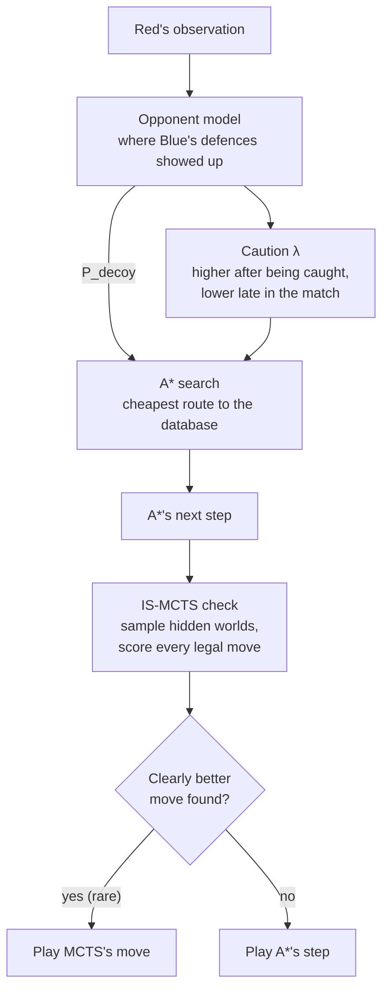

How one IS-MCTS search works, up to 1000 times or 200 ms per move:

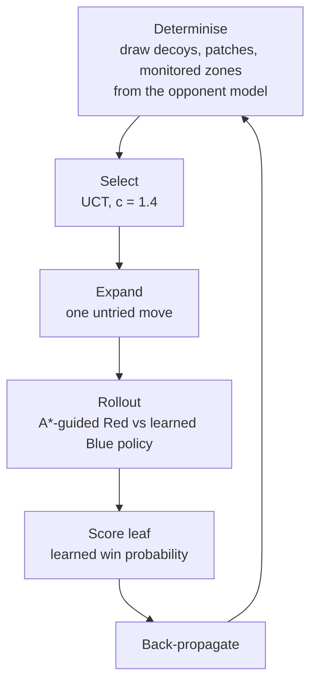

| Technique | File | What it does |
| --- | --- | --- |
| **A\* search** | `agents/red/astar.py` | Plans the cheapest route to the database over the nodes Red knows. Step cost `1 + λ·risk(v)` plus the expected number of retries, with `risk(v) = sensitivity × (1 − weakness) + P_decoy(v)`. Unknown territory is reached through optimistic "fog" links, and the straight-line heuristic never overestimates, so A\* stays optimal. |
| **Information-Set MCTS** | `agents/red/ismcts.py` | Red cannot see decoys, patches or monitored zones. Each sample draws a full hidden state from the opponent model (determinisation), and every candidate first move is played from that same sample with the same random numbers (paired sampling), then UCT (`c = 1.4`) with availability counts, expansion, an A\*-guided rollout and back-propagation. Inside the rollouts Blue follows a response policy learned from 160 logged matches, and a leaf is scored by a logistic-regression win probability fitted on the same matches (`tuning/learn_from_matches.py`). Up to 1000 rollouts or 200 ms per move. MCTS overrides A\*'s step only when a paired test says it is better by a margin and about two standard errors. |
| **Opponent model** | `agents/red/opponent_model.py` | Counts where Blue's defences have shown up (zones where Red got caught, decoys found, nodes isolated just before Red stepped on them, failed captures) and turns the counts into Laplace-smoothed probabilities. They feed `P_decoy` in A\* and the sampling in MCTS. |

### Blue AI: track the unseen, defend ahead

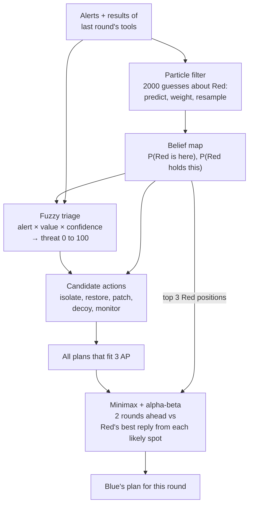

| Technique | File | What it does |
| --- | --- | --- |
| **Bayesian particle filter** | `agents/blue/particle_filter.py` | 2000 particles, each a full guess about Red: the node it stands on and the set of nodes it holds. Predict (move along a link, biased toward the database), update (weight by the likelihood of the alerts and by how well each held set explains Blue's own isolate/restore results), systematic resampling. The share of particles holding a node is P(Red holds it now), which drives restores. A sprung decoy collapses the belief onto one node. |
| **Fuzzy logic triage** | `agents/blue/fuzzy.py` | A Mamdani system with triangular memberships turns alert strength, node value and belief confidence into a threat score from 0 to 100 (12 rules, centroid defuzzification). Below `watch` Blue ignores a node, above `act` it acts. |
| **Minimax + alpha-beta pruning** | `agents/blue/stackelberg.py` | Blue moves first and Red replies, so Blue maximises over its own plans and assumes Red minimises with its best reply. Blue builds candidate allocations of its 3 action points, and for each one assumes Red's best response (fast route search on Blue's map) from each likely Red position. It looks two rounds ahead with alpha-beta pruning and picks `argmax_a Σ_p b(p) · min_r U(a, p, r)`. |
| **Genetic algorithm** | `tuning/ga.py` | Tunes either side offline (`--side blue` or `--side red`): Blue's 13 weights (utility weights, fuzzy thresholds and membership peaks, particle motion model) and Red's 6 (A\* caution λ and how it changes, and the two MCTS override thresholds). Tournament selection (size 3), uniform crossover, Gaussian mutation, elitism of 2. Fitness is the side's win rate against the other side's current AI (Blue also gets a bonus for locating Red early), measured with racing: everyone plays the first third of the maps, the better half the second third, the best quarter all of them. Weights are saved to `tuning/best_weights.json` (Blue) and `tuning/red_weights.json` (Red) and loaded automatically. |

How the genetic algorithm tunes a side:

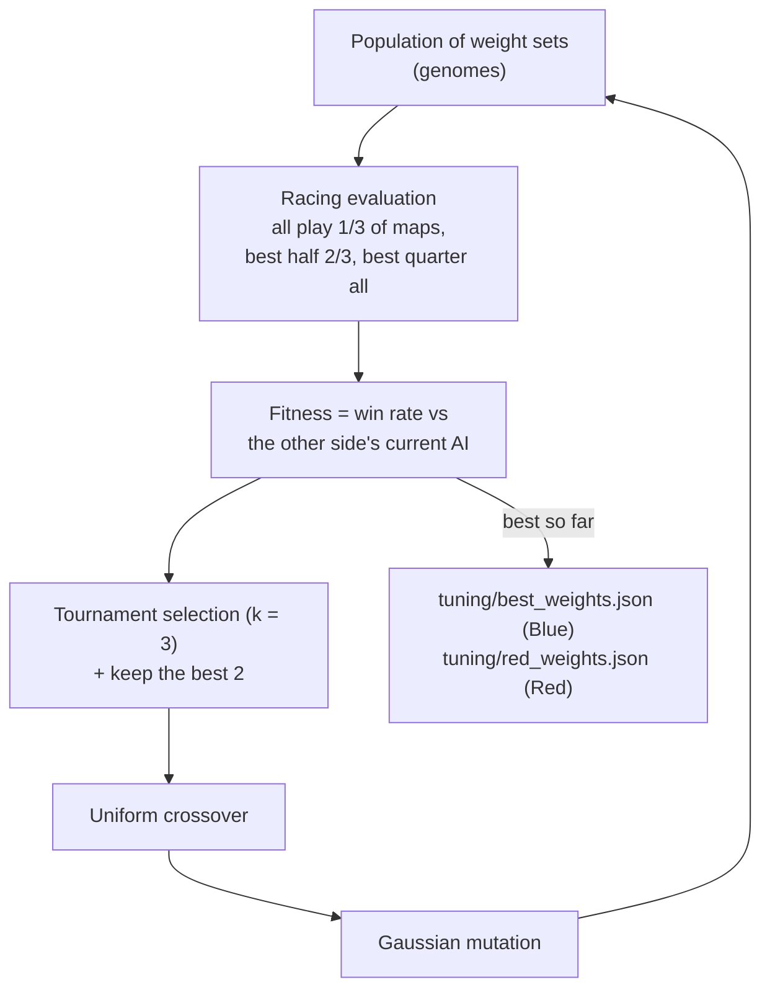

The GA was run as co-evolution, taking turns between the two sides:

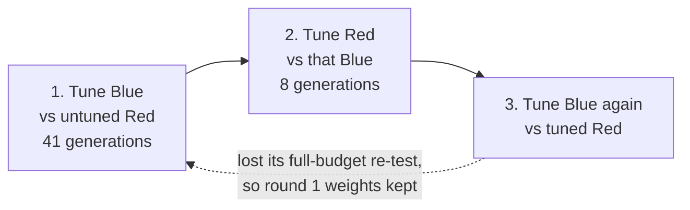

Baseline random agents for both sides live in `agents/baseline/`.

---

## Evaluation

```bash
python -m experiments.run_batch --suite --matches 100   # every pairing in the table, fixed seeds
python -m experiments.charts                            # win-rate chart and GA fitness curve
python -m tuning.learn_from_matches --matches 160       # re-learn MCTS's Blue model and leaf value
python -m tuning.ga --side red --pop 14 --gens 8 --matches 30     # tune Red against the current Blue
python -m tuning.ga --side blue --seed-from tuning/best_weights.json   # tune Blue (warm start)
python -m tuning.ga --resume                            # continue a stopped GA run
```

100 matches per pairing on the same fixed seeds (maps 1 to 100), full search budgets, both AIs using
their GA-tuned weights:

| Pairing | Red wins | Blue wins | Avg rounds (Red win) | Blue first locates Red |
| --- | --- | --- | --- | --- |
| **Red AI vs Blue AI** | **58%** | **42%** | 27.4 | round 2.9 |
| Red AI vs random Blue | 100% | 0% | 12.1 | - |
| Random Red vs Blue AI | 0% | 100% | - | round 3.2 |
| Ablation: Red with A\* only (no MCTS) | 58% | 42% | 27.4 | round 2.9 |
| Ablation: Blue without the particle filter | 87% | 13% | 22.6 | round 3.7 |
| Ablation: Blue before GA tuning | 59% | 41% | 26.7 | round 3.1 |
| Ablation: Red before GA tuning | 39% | 61% | 26.1 | round 2.9 |

What this shows:

- The main match stays inside the 40 to 60% target from the outline (58 / 42), with Red slightly ahead.
- Both AIs beat a random opponent in every match.
- The particle filter is still Blue's most important part: without it Blue wins only 13% instead of 42%.
  Its new held-node sets cut Blue's error about which nodes Red holds from 5.5 to 3.2 nodes per round
  and raised the share of restores that take a node back from 34% to 45% (60 test matches).
- Tuning Red was worth 19 points: the untuned Red wins 39%, the tuned one 58%. The GA made Red bolder
  (λ 1.0 → 0.4, less extra caution after being caught) and raised the bar for MCTS to overrule A\*.
- The GA was run as co-evolution: Blue first (41 generations, 30 × 30), then Red against that Blue
  (8 generations, 14 genomes, racing), then Blue again against the tuned Red. The third round's best
  genome won its fast-budget re-test but lost at full budget (36% instead of 42%), so we kept the
  first-round Blue weights; the round-3 genome is saved as `tuning/best_weights_round3.json`. Against the
  tuned Red, Blue's tuning is worth only 1 point (41% → 42%); against the untuned Red it was 8.
- MCTS was rebuilt to give it a fair chance: Blue's behaviour inside the rollouts is now learned from
  160 logged matches, leaves are scored by a learned win probability, and every candidate move is
  compared on the same sampled worlds with a paired significance test. That made its estimates precise
  enough to trust, and the experiments then gave a clear answer: whenever MCTS overruled A\* (with
  thresholds of 0, 0.02, 0.03 and 0.06) Red won the same or less. The GA independently set the threshold
  to 0.11, where MCTS still runs every move, shows its numbers in the Red panel and acts as a check, but
  overrules A\* almost never, so the "A\* only" row equals the full Red. With a good cost model, A\*'s
  step is already close to the best single move against this Blue.

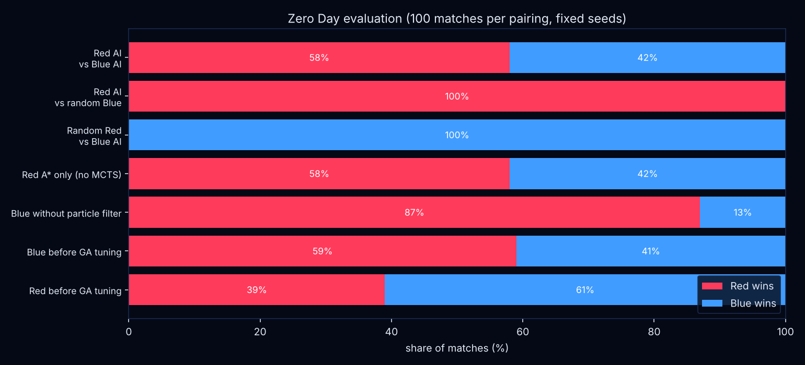

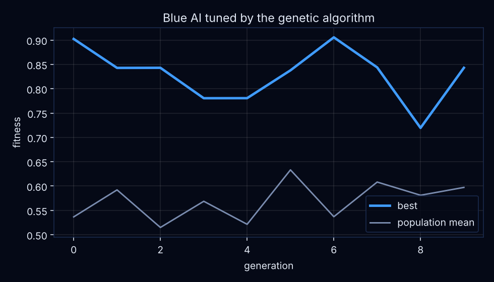

---

## Project structure

```
engine/          game state, rules, alert model, map generator, observations, match runner
agents/red/      astar.py, ismcts.py, opponent_model.py, agent.py
agents/blue/     particle_filter.py, fuzzy.py, stackelberg.py, agent.py
agents/baseline/ random agents for both sides
tuning/          ga.py (both sides), learn_from_matches.py, tuned weights, learned MCTS models, fitness curves
ui/              Pygame app: menu, online lobby, network renderer, panels, effects, human input
net/             online play: TCP link, LAN discovery, relay (WebSocket) link, lockstep match protocol
server/          relay server for online play through the internet and the browser (Render / Fly.io)
tools/           browser build (pygbag), desktop build (PyInstaller), browser smoke test
experiments/     headless batch runner, charts, results
tests/           engine, online lockstep and resync, relay, phone layout, cut-off and AI-part checks
.github/         workflows: browser build + GitHub Pages, desktop builds on v* tags
```

## Tests

```bash
pip install pytest
python -m pytest -q
```

The tests cover the rules engine, the observations each side gets (so neither AI can peek), two copies of
a match staying in lockstep over the network and through the relay (including repairing a forced desync),
the phone layouts, the Red "cut off" case, and the AI parts (particle held sets, paired MCTS sampling,
the learned models and the GA genes). The browser build also gets a smoke test in GitHub Actions (`tools/web_smoke.py`): it
loads the page in headless Chromium, starts a match, and taps through the phone layout.

## Balancing notes

The outline said costs, noise levels and probabilities were starting values to be tuned. Batch runs showed
the first version was far too strong for Blue (Red won 0% of matches), so these were changed:

- Unlock is one action that crosses the border and takes the node behind it (it used to be two actions).
- Restore costs 2 and cannot pull Red off the node it is standing on (that is what Isolate is for).
- Isolate lasts 2 rounds, only one node can be isolated at a time, and it needs 2 rounds to recharge.
- Patch works once per node. Each failed capture makes the next try on that node a little easier.
- Scouting also maps the neighbours' links. The gateway can only be sealed after round 15 and costs 3 points.

Every knob is in `engine/config.py`.

## Known limitations

- The free Render relay sleeps after 15 minutes idle, so the first online game after a break can take
  up to a minute to connect.
- Settings in the browser version only last until the tab is closed.
- The desktop apps aren't code-signed, so Windows and macOS show a warning the first time.

## Credits

Fonts: IBM Plex Sans, IBM Plex Mono and Barlow Condensed (paper theme), Inter and DejaVu Sans Mono (dark theme), all under free licences; see `assets/fonts/`.
